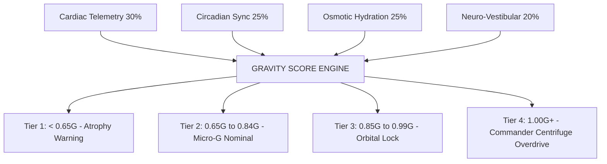
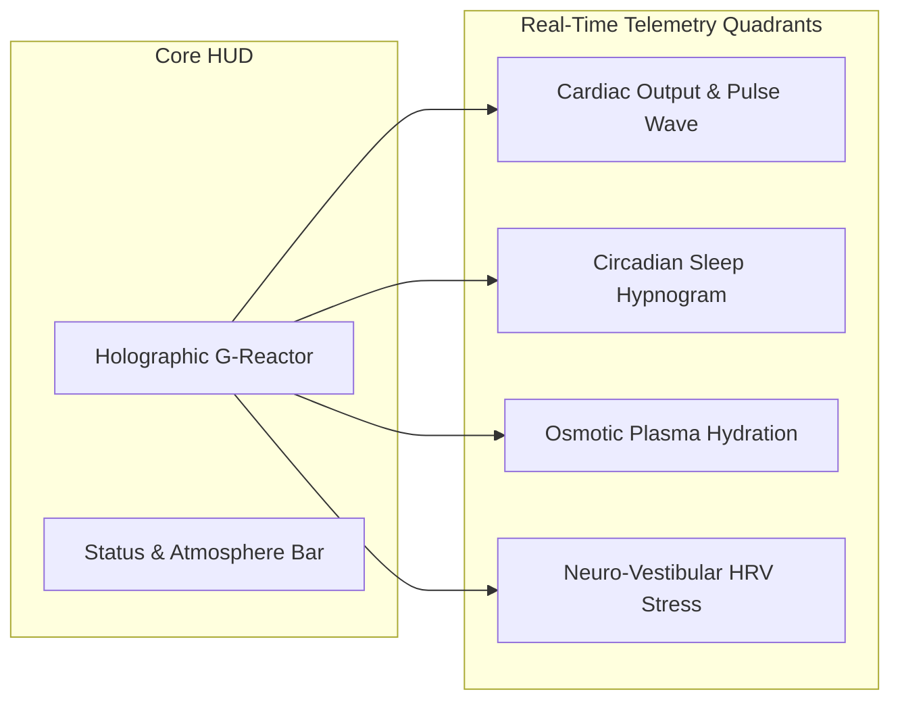
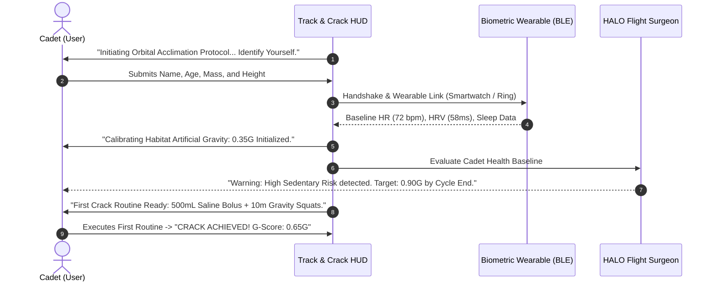

# Track and Crack: Zero-G Astronaut Health Telemetry System
*A High-Performance Biometric, Circadian, and Neuro-Vestibular Optimization Suite*

---

---

## 1. Executive Summary & Design Vision

In spaceflight, microgravity wreaks havoc on human physiology: bone density decays at 1% per month, fluid rushes cephalad (towards the head) causing ocular pressure and cardiovascular deconditioning, circadian rhythms fracture under 16 daily sunrises, and the vestibular otolith organs become disoriented.

**Track and Crack** gamifies earthly health, physical fitness, and psychological resilience through the lens of an **Orbital Specialist training in high-fidelity zero-gravity environments**. The app reframes wellness metrics (heart rate variability, deep sleep, osmotic hydration, and stress mitigation) as anti-atrophy countermeasures needed to withstand deep-space exploration. 

The central mechanic—**The Gravity Score (G-Score)**—represents the cadet's physiological earth-equivalence. Users "Crack" daily zero-gravity stress vectors by completing micro-missions and maintaining optimal biometrics.

---

## 2. The Gamified Core: The Gravity Score ($G$-Score)

### 2.1 The Concept & Formula
Earth gravity is defined as **$1.00\text{ G}$**. In space without exercise and rest, a human's physiological resistance drops down to $0.20\text{ G}$ (vulnerable to severe osteopenia, orthostatic intolerance, and muscular atrophy). 

The app computes a dynamic, real-time Gravity Score ($0.00\text{ G}$ to $1.20\text{ G}$) continuously aggregating four vital biometrics:

$$\text{Gravity Score (G)} = \left( 0.30 \cdot S_{\text{HR}} + 0.25 \cdot S_{\text{Sleep}} + 0.25 \cdot S_{\text{Hydration}} + 0.20 \cdot S_{\text{Neuro}} \right) \times 1.15$$

Where:
*   **$S_{\text{HR}}$ (Cardiovascular Reserve):** Evaluates resting heart rate against historical baseline, arterial pulse wave velocity, and cardiovascular recovery under load.
*   **$S_{\text{Sleep}}$ (Orbital Circadian Lock):** Ratio of restorative sleep (Deep + REM) against circadian phase target. ISS astronauts experience circadian slippage; quality deep sleep scores highest.
*   **$S_{\text{Hydration}}$ (Osmotic & Plasma Volume):** Hydration volume + electrolyte balance ratio to mitigate microgravity fluid-shift edema and hypovolemia.
*   **$S_{\text{Neuro}}$ (Neuro-Vestibular Calm):** HRV RMSSD balance and parasympathetic recovery (low score = Space Adaptation Syndrome disorientation).

### 2.2 Cadet Ranking & "Cracking" Mechanics
*   **"Cracking" the Threshold:** Every day, orbital stressors attempt to decay the user's G-Score. Completing targeted habits (cardio intervals, 500mL electrolyte bolus, 5-minute visual saccadic breathwork) triggers the **"CRACK" animation**—a holographic soundwave breaking through the zero-G stasis field.
*   **Astronaut Cadence Tiers:**
    1.  *Tier I: Terrestrial Recruit* ($0.00 - 0.64\text{ G}$) — High deconditioning risk.
    2.  *Tier II: Low Earth Orbit Specialist* ($0.65 - 0.84\text{ G}$) — Balanced baseline.
    3.  *Tier III: Lunar Operator (Orbital Lock)* ($0.85 - 0.99\text{ G}$) — High resilience.
    4.  *Tier IV: Deep Space Centrifuge Commander* ($1.00 - 1.20\text{ G}$) — Peak human biomechanical and neuro-vestibular threshold.

---

## 3. Real-Time Telemetry Dashboards

### 3.1 Cardiovascular Telemetry (Heart Rate & Fluid Redistribution)
*   **Live Waveform HUD:** Real-time photoplethysmogram (PPG) / ECG rendering with glowing cyan pulse vectors.
*   **Microgravity Fluid Shift Indicator:** Calculates cephalic vascular volume based on posture sensors, pulse arrival time, and resting HR. Alerts cadet when prolonged sedentary posture simulates zero-G fluid pooling.
*   **ARED Resistance Load Monitor:** Tracks cardiovascular strain during high-resistance concentric/eccentric workouts (simulating the Advanced Resistive Exercise Device on the ISS).

### 3.2 Orbital Circadian Sync (Sleep Architecture)
*   **Orbital Cycle Tracker:** In low Earth orbit, the station passes through 16 sunrises and sunsets every 24 hours. The app visualizes sleep as an orbital solar shield window.
*   **Hypnogram Stage Analyzer:** Breakdown of Deep, Light, REM, and Micro-Awakenings, tracking sleep debt and circadian phase-shifts.
*   **Chrono-Light Guidance:** Prescribes dynamic blue-light spectrum exposure windows in the morning and amber-red dimming at night to maintain melatonin synthesis in simulated sealed-cabin environments.

### 3.3 Osmotic Hydration Matrix
*   **Plasma Volume Retention Index:** In zero-G, the body sheds ~15% of blood plasma due to cephalic fluid perception. The app tracks not just H₂O ounces, but the **Saline/Electrolyte Balance** essential for maintaining blood pressure and cognitive performance.
*   **Smart Hydration Bolus Timers:** Recommends targeted 250mL - 500mL mineral pushes before workouts, after waking, and before atmospheric reentry sleep.

### 3.4 Neuro-Vestibular Balance (Stress & Space Adaptation Syndrome)
*   **HRV Autonomic Tone:** Uses RMSSD (Root Mean Square of Successive Differences) and Baevsky’s Stress Index to gauge sympathetic overdrive.
*   **Space Adaptation Syndrome (SAS) Mitigation:** Guided 3D gyroscopic visual breathing routines (e.g. box breathing synced with moving orbital reticles) to reset the vestibular-ocular reflex and alleviate nausea, panic, or brain fog.
*   **Cognitive Agility Benchmark:** 60-second reaction time and spatial orientation test to detect neuro-fatigue.

---

## 4. Comprehensive Feature Architecture

| Feature Module | Space-Themed Feature Name | Real-World Functionality | Telemetry Input |
| :--- | :--- | :--- | :--- |
| **Biomechanics** | **ARED Heavy Centrifuge** | Progressive overload strength tracking & anti-osteopenia logging | Accelerometer, BLE Smart Weights, Apple HealthKit |
| **Cardio Engine** | **Orbital VO₂ EVA Thrusters** | Zone 2 / Zone 5 cardiovascular interval training & stamina tracker | Optical HR, GPS / Treadmill CAD |
| **Hydration** | **Osmotic Life-Support Pod** | Dynamic electrolyte, sodium, and water tracking with dehydration alerts | Manual log, NFC smart bottle integration |
| **Chronobiology** | **Solar Lock Sleep Chamber** | Sleep staging, circadian rhythm realignment, and smart haptic orbital alarm | Sleep tracker, wearable sleep stages |
| **Neuro-Calm** | **Aero-Vestibular Decompress** | Ocular saccadic training, HRV biofeedback, 4-7-8 breathing sessions | Live HRV, Front camera gaze tracking |
| **Social / Co-op** | **Crew Station Telemetry** | Team leaderboards, shared orbital station survival streaks, and PvP duels | Station Cloud Sync / WebSocket |
| **AI Assistant** | **HALO (Orbital AI Surgeon)** | Context-aware telemetry coaching ("Cadet, cephalic pressure high; initiate 300mL electrolyte bolus") | Multi-modal biometric engine |

---

## 5. UI Layout & Visual Design System

### 5.1 Color Palette & Glassmorphic Token System
*   **Deep Space Void (Background):** `#050814` to `#0B132B`
*   **Bioluminescent Cyan (Primary HUD / Data):** `#00F0FF` (Glow: `rgba(0, 240, 255, 0.45)`)
*   **Solar Amber (Alerts / Energy / Overdrive):** `#FFB800` (Glow: `rgba(255, 184, 0, 0.45)`)
*   **Centrifuge Green (Optimal Status / Nominal):** `#39FF14`
*   **Radiation Crimson (Critical Warning / Atrophy Risk):** `#FF2A6D`
*   **Surface Panels:** Semi-transparent smoky acrylic `rgba(13, 23, 44, 0.75)` with `1px border border-cyan-500/20` and `backdrop-filter: blur(16px)`.

### 5.2 Mobile Screen Architecture
1.  **Tab 1: Mission HUD (Main Dashboard):**
    *   Top status pill: Vessel name (`HAB-07`), Orbit time, Life Support status.
    *   Central holographic gauge: Rotating concentric vector rings with live `Gravity Score (e.g. 0.88G)` and tier badge (`ORBITAL LOCK`).
    *   4 Quick-Telemetry Glassmorphism cards: Cardiac BPM with live ECG line, Sleep hypnogram, Hydration volume progress, and Neuro-Stress index.
    *   Bottom: "Crack the Void" daily countermeasure missions.
2.  **Tab 2: Telemetry Matrix (Deep Analytics):**
    *   Granular multi-axis graphs comparing heart rate variability vs. sleep consistency.
    *   Bone density & muscle volume retention estimates based on weekly mechanical tonnage lifted.
3.  **Tab 3: Training Chamber (Workouts):**
    *   Zero-G calisthenics, isometric tension drills, HIIT thrusters, and resistance tracking.
4.  **Tab 4: Station Crew (Social):**
    *   Crew roster with co-astronaut G-scores, shared mission milestones, and emergency ping system.

---

## 6. Sample Onboarding Flow: "Cadet Induction Protocol"

### Step-by-Step Scripted Onboarding Experience

#### Screen 1: The Airlock Welcome
*   **Visual:** Deep space starry canvas with an atmospheric ring that gently pulses. High-tech sci-fi typography.
*   **Audio/Haptics:** Low frequency sub-bass rumble, pneumatic airlock depressurization sound effect.
*   **Text:** 
    > *"WELCOME TO ORBITAL STATION T-C1. You are entering microgravity conditions where terrestrial muscles decay and circulation shifts. To survive and excel in deep space, you must track your vitals and crack your physiological limits."*
*   **Action:** Cadet taps glowing button: **[ INITIALIZE SUIT TELEMETRY ]**

#### Screen 2: Biometric Sync & Sensor Handshake
*   **Visual:** Rotating 3D holographic wireframe astronaut avatar.
*   **Text:** 
    > *"Pairing with biometric sensor node (Apple Watch, Garmin, Oura, or Phone CoreMotion)..."*
*   **Feedback:** As connection succeeds, glowing cyan telemetry rings wrap around the avatar's wrist, chest, and head.
    *   ✓ Cardiac Optical Sensor: Linked
    *   ✓ Chrono-Sleep Accelerometer: Linked
    *   ✓ Gyroscopic Vestibular Sensor: Linked

#### Screen 3: The Baseline Deconditioning Scan
*   **Prompting Cadet Inputs:**
    *   Resting baseline & physical training volume.
    *   Target sleep window (setting simulated orbital sunset).
    *   Daily fluid replenishment target.
*   **Calculation:** The screen calculates the cadet's starting **Gravity Baseline**:
    > *"Initial Status: Cadet Tier 2 — 0.58 G. Vulnerable to muscle loss and circadian desynchronization."*

#### Screen 4: Mission Briefing & The First "Crack"
*   **Text:**
    > *"To lock your orbit and crack 0.85G today, your crew requires your first countermeasure: Drink 350 mL of water and complete 10 deep bodyweight squats to counteract fluid pooling."*
*   Cadet taps **[ EXECUTE MISSION ]**.
*   Upon completion, screen flashes with solar gold particles, a sharp satisfying kinetic haptic pulse fires:
    > *"CRACK CONFIRMED! +0.15G INJECTED. CURRENT GRAVITY SCORE: 0.73G. WELCOME ABOARD, SPECIALIST."*

---

## 7. Interactive Prototype Widget

An interactive standalone HTML widget has been built to test the real-time mathematics and HUD interactions.
*   **Widget File:** [track_and_crack_hud.html](file:///C:/Users/umang/.gemini/antigravity/brain/e926d885-bb7d-4e42-a644-d0a4597507b6/track_and_crack_hud.html)
*   Cadets can drag real-time sliders for Heart Rate, Sleep, Hydration, and Stress to see the holographic reactor gauge react dynamically with color-coded tier transitions.
